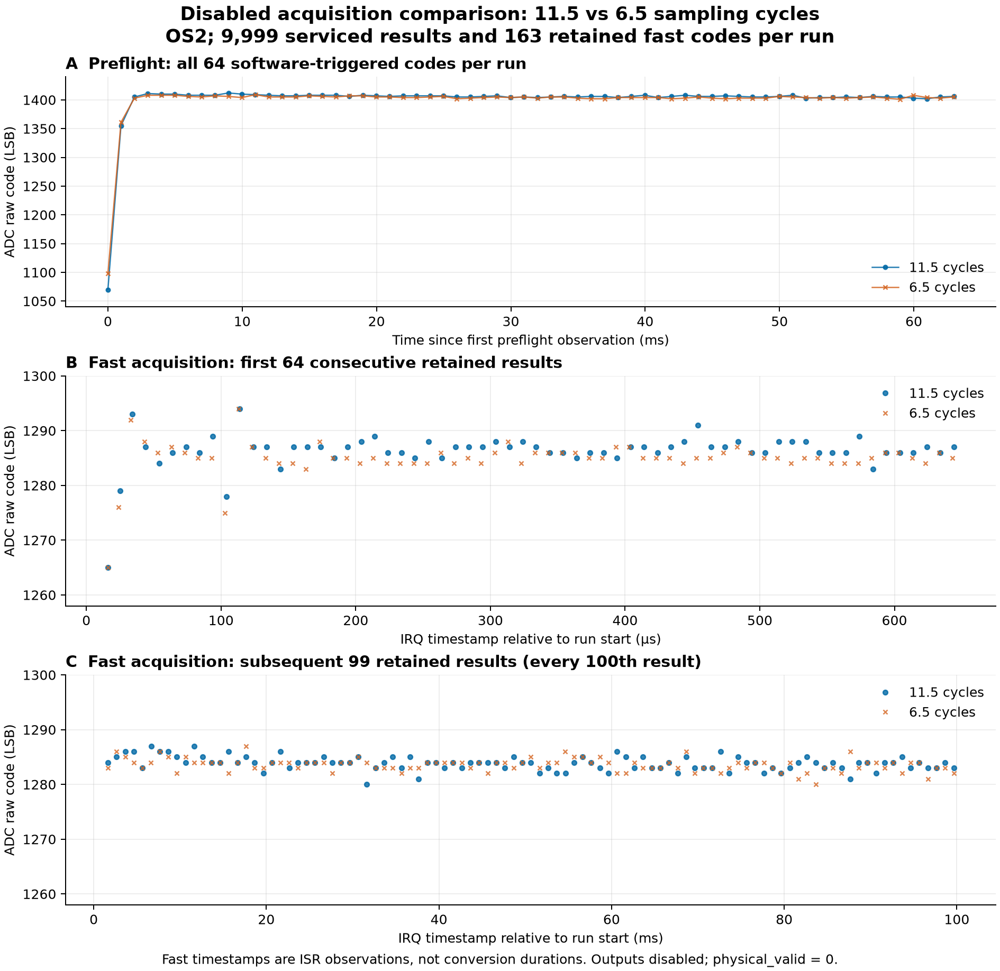

# 禁能 PWM 采集：11.5 / 6.5 cycles 对照

本次两个独立启动均完成 100 ms 禁能采集并恢复资源。两组快速采集原码分布接近；将采样时间从 11.5 改为 6.5 cycles，没有消除快速采集与预采集、常规 G01 采集之间的原码水平差异。

| 项目 | 11.5 cycles（scenario 0） | 6.5 cycles（scenario 8） |
|---|---:|---:|
| 已服务 ADC 输出结果 | 9999 | 9999 |
| 全结果原码下限 | 1265 | 1265 |
| 全结果原码上限 | 1294 | 1294 |
| 固件记录最大采样 IRQ 间隔 / µs | 10 | 10 |
| 截止检查最大 IRQ 间隔 / µs | 100 | 100 |
| start/stop 软件时间差 / µs | 100002 | 100001 |
| 首条 preflight 至 start / µs | 63988 | 63990 |
| preflight 保留数 / fast 保留数 | 64 / 163 | 64 / 163 |

下表均为所保留原码的描述统计；标准差采用总体标准差，单位为 ADC LSB。preflight 后 48 点单列以展示启动后的水平，全部 64 点仍保留在数据和图中。

| 原码区间 | 11.5 cycles：均值 / SD / 最小–最大 | 6.5 cycles：均值 / SD / 最小–最大 |
|---|---:|---:|
| preflight 全部 64 点 | 1400.281 / 42.140 / 1070–1412 | 1399.062 / 38.350 / 1098–1409 |
| preflight 后 48 点 | 1405.667 / 1.434 / 1402–1408 | 1404.062 / 1.435 / 1401–1408 |
| fast 首 64 点 | 1286.281 / 3.529 / 1265–1294 | 1284.859 / 3.513 / 1265–1294 |
| fast 后续抽样 99 点 | 1283.848 / 1.274 / 1280–1287 | 1283.545 / 1.166 / 1280–1287 |

后续 99 点抽样均值差（6.5 − 11.5）为 -0.303 LSB。本次各只有一个独立运行，不能据此建立重复性或确定哪一种采样时间更准确。

同轮资源恢复后的常规 G01 MCU 电流通道 30 点原码为 986–991，均值 989.033 LSB，记录开始时间间隔为 500–500 ms。它与本次 preflight/fast 的采样配置、触发方式、运行时间不同，只作为现象背景；不能把差值归结为节拍的唯一因果，也不能换算为实际放电电流。

证据口径：

- 每组服务 9,999 个 OS2 ADC 输出结果；它不是 9,999 份已上传原码，也不是内部单次转换的数量。fast 原码仅保留前 64 点，随后每 100 点保留一条，共 163 条。全结果均值和标准差无法从抽取轨迹恢复；状态极值覆盖全部已服务结果。
- fast 时间戳在 ISR 观测时记录；preflight 在轮询读取结果后记录。图上间隔、软件 start/stop 差值和 IRQ 间隔不能代替转换开始/完成时间或电气关断时间。
- 11.5 / 6.5 cycles 为场景选择对应的固件配置，状态协议没有独立回读 SMPR 寄存器。两组均为 ADC 64 MHz、TIM1 400 MHz、时间戳定时器 1 MHz，ARR=2000、CCR=1000、DTG=0。
- 每条 trace 和已解析状态的 actual_bits=0；终态 DONE、faults=0、owned=0、restored=1、timer_running=0。power_capable=0、physical_valid=0。该结果仅覆盖禁能采集和本地截止，不构成 PWM 引脚、驱动、电气死区或真实放电验收。
- 已复核 result 中全部工件 SHA-256；serial.bin 内 G3P/G3E 的 CRC、身份和禁能字段通过解析，原始报文中的 trace 与 trace.json 一致。

输入：[11.5 cycles 结果](../board-suite-01/01-normal/result.json)、[6.5 cycles 结果](../board-suite-01/02-sample-6p5/result.json)、[常规 G01 原始表](../resource-recovery-01/g01.csv)。派生工件：[统计与输入哈希](summary.json)、[保留样本](retained-samples.csv)。

固件 SHA-256：9126778404c6f9a9890ab729522f7fbd9fe7fe0a380436694494ebecde81f9fb。
