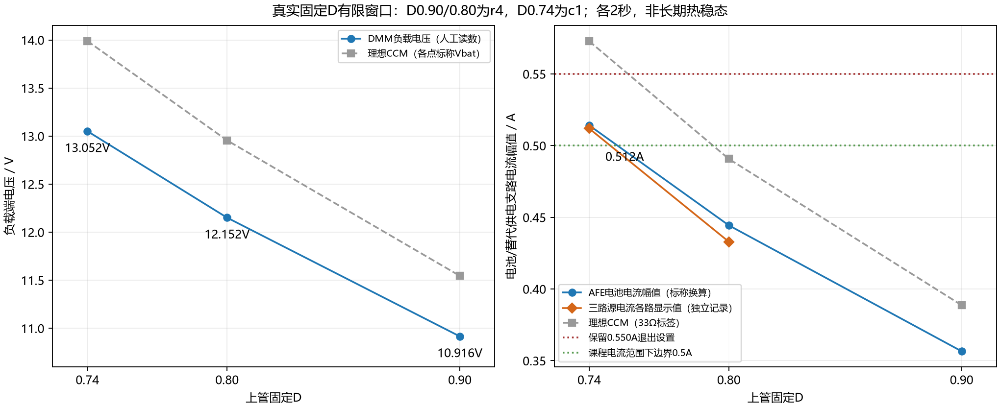
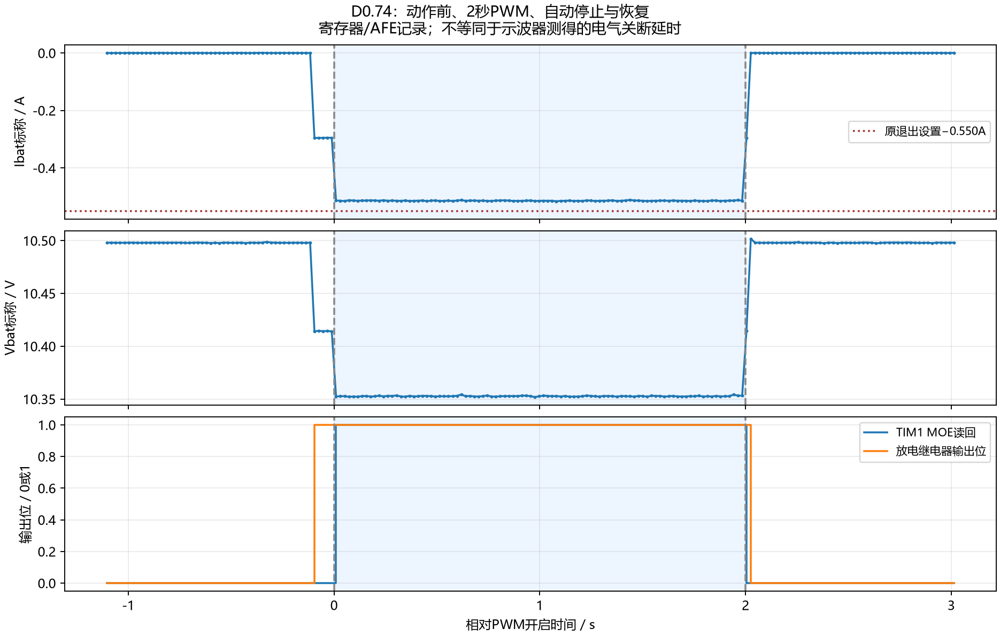

# G03新增约0.5A固定D放电结果

验收日期2026-11-03，实测2026-11-02。保持三路限流电源代替实电池、33Ω/25W标签负载和原0.550A退出设置，完成固定D0.74短点及2秒点。2秒窗口中三路电源均显示0.512A，DMM负载电压13.052V，AFE电池电流中位数-0.514216A（标称换算）。自动截止与恢复通过。已取得约0.5A的功能展示点；未将它宣称为最终电流精度或长期热稳态验收。

## 已完成点

|工况|CCR/ARR|实际PWM软件窗口|AFE标称电池电流/A|电源各路显示/A|负载表测/V|结果|
|---|---|---|---:|---:|---:|---|
|原r4 D0.90|1800/2000|2.000072s|-0.356608|未取得|10.916|通过、保留|
|原r4 D0.80|1600/2000|2.000072s|-0.444433|未取得|12.152|通过、保留|
|r4 D0.80电流补测|1600/2000|2.000072s|-0.445097|0.433|未取得|通过|
|c1 D0.74短点|1480/2000|0.100075s|-0.513752|未取得|未取得|通过|
|c1 D0.74记录点|1480/2000|2.000074s|-0.514216|0.512|13.052|通过|

负载电流13.052/33=0.395515A是电阻标签换算，不是电池电流；三路0.512A不相加。各电源显示是替代电芯供电支路读数，独立支持约0.5A输出，但没有同步采集或在此完成仪器校准。未用单点比例修改AFE系数。D0.80补测未读到电压，不用旧12.152V补填该run。

同一接线与电源设置下，D0.80→0.74时电源各路显示0.433→0.512A，AFE标称电流也更负，支持局部D减小、放电幅值增大。原r4到c1仅扩展固定点白名单和身份，正常驱动/监测路径及阈值未改；不将局部趋势外推成整个范围已验证的模型。图中理论线为理想CCM模型，不填充未做点。

## 停止、恢复与质量

长点197条记录、95个完整PWM样本，最后0.5秒24个完整样本，电流范围-0.515675～-0.512093A。软件PWM截止2000074us、随后继电器保持20100us；故障0，输出位0，资源恢复1，令牌已用1。用户报告其余无异常，随后明确确认三路OFF；最后串口状态独立核对一致。最后状态live=1表示该记录使用真实输出模式，不表示当前仍在输出。

温度GPIO2/3/4活动期中位原码分别3201/3205/3198，Celsius留空。physical_valid=0表示物理标定未完成，不把它改成1。PA1不作唯一快速保护，ADC2负载电压未验证换算，不用于制造电压曲线。

## 固件与冻结工况

实板身份g03-power-d74-c1，Release HEX SHA256 `001577eeccc6ab3d264283cb4d85be17e19051a08dccc2eb983f02fd9da2d4ab`。Release构建0错误0警告；受影响端口12项（含D74固定CCR、截止、STOP、过流、CCR异常、心跳与防运行中改点）及主机13项通过，烧录读回通过，新镜像默认关闭和D74禁能核对通过。完整构建输入在build-source，构建清单在build/source-manifest.json；旧r4修改前文件在source-before。未提交修改和旧失败记录保留。

三路各3.500V、CC0.600A、OCP0.550A启用、OVP3.650V启用；CH1→左A/cell13，CH2→中B/cell7，CH3→右C/cell1，各黑端不互连，真实电池在板外，黄色口空，绿色33Ω接牢，原18V只按既有辅助/继电器供电使用。单节启动3.45～3.55V、运行3.30～3.65V，Ibat标称退出−0.550/+0.050A，基线和通路确认带均保持。

独立本地截止、STOP优先、数据失效关断、故障锁存、一次令牌、固定D和防重放保留。电源CC/OCP约束持续供能及锁断，延时未测；33Ω和短脉冲不被当成内部短路峰值上限。未建立电源输出电容及板内全部储能的量化界限，也未宣称周期级过流保护已验收。

## 本轮失败和差异记录

- new-image-dry-01：助手安排三路OFF，但禁能路径仍检查真实单节电压，读到近0V后退出；49条、实际继电器/PWM均未开启，faults=0x220008，保留fail。属于工况安排错误，未改阈值掩盖。
- new-image-dry-02：MCU未实际复位，主机在used1时拒绝启动，只发了状态查询；保留fail。
- 静态36条/0解析错误确认三节约3.5V后，一次ST-LINK复位生效，new-image-dry-03完成106条、100075us软件窗口、故障0、真实输出始终关闭。dry结果中的actual_pwm_started字段仅由软件时间戳推得，不能理解为物理PWM已开启。
- reset-before-short-01接口返回Error32，未重试复位；独立串口确认新启动、used0/faults0/bits0后才继续首个真实短点。该接口失败原样保留。
- 老师新上传DOCX与docs/course旧版本逐字节一致，SHA256均为5f8b027080aa93b1905be925cbd0828aafd45f769110e780513fd4c380ea4a72。没有新增充电上限或放宽电流依据。老师D0.758/0.5A是闭环例子，不冒充本项目固定D数据。

## 明日可展示及剩余差项

可展示D0.90、0.80、0.74三种固定D真实响应，以及D0.74约0.5A、2秒本地截止与恢复。D0.74是额外探索点，不替代课程D0.70。课程D0.70/0.60/0.50/0.40仍未执行；原10.5V/33Ω理想电池电流分别0.649/0.884/1.273/1.989A，与现有0.550A工况不相容，不直接提高阈值凑点。现场仅有33Ω时，六点不能在同一电压、同一负载下全部保持0.5～0.8A。

更高电流需新的有依据工况，低D还需母线电压/尖峰及负载范围依据。充电侧仍未接入：原实电池板外3.885/3.886/3.886V，与当前电压工况不相容；允许充电参数及实电池故障供能切断路径未确认。缺探头的物理波形、死区和电气关断延时仍缺测；不以这些缺项撤销本次有效功能点。不要求完整SOC或重做无关G01/G02。

数据入口：[本轮CSV](completed-points.csv)、[汇总CSV](consolidated-points.csv)、[现场操作](operation-guide.md)、[原r4报告](../20261102-G03-discharge-sprint-r4/report.md)、[扩点/充电约束核算](../20261102-G03-extension-readiness-r1/review.md)。
