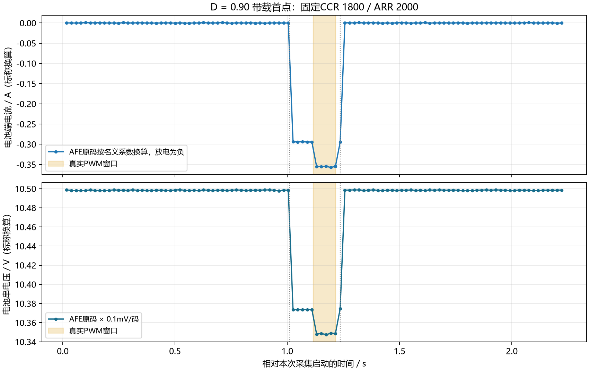
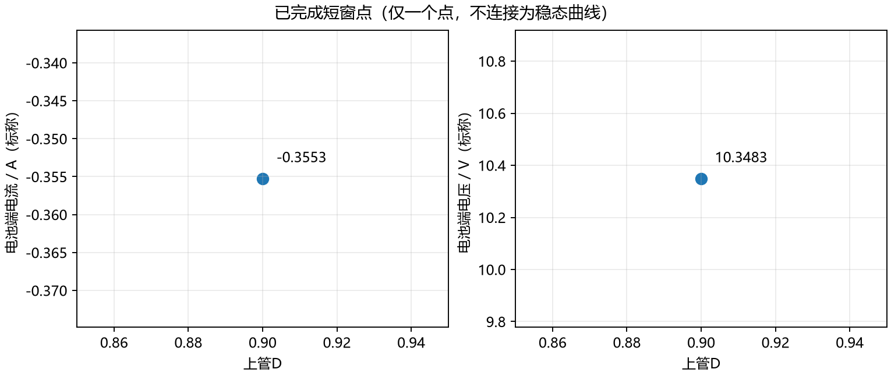

# G03放电首个带载PWM结果

2026-11-02，r2 / live-d90-01 完成一个真实固定D放电短点，停止与恢复通过。status: completed（本次单点）；verdict: pass；evidence_scope: 板上真实PWM命令、寄存器、AFE原码响应与软件停止恢复。G03全项仍进行中。

|项目|结果|
|---|---|
|上管D / 实际CCR / ARR|0.90 / 1800 / 2000，全记录一致；活动期输出位19|
|记录数|106组；完整PWM内样本4组；跨停止边界样本单列|
|电池串电压|基线10.4983 V；PWM内中位10.34835 V；恢复10.4983 V（AFE标称换算）|
|电池支路电流|基线0；仅继电器−0.29425 A；PWM内−0.35528 A；恢复约+0.00013 A（本次零点8998码，名义系数）|
|PWM增量|相对被动负载−0.06103 A，说明PWM开启后放电增加|
|PWM软件窗口|100072 us；记录点是软件寄存器操作，不是探头测得的Vgs边界|
|PWM关闭后继电器保持|20100 us，修复后的顺序通过|
|结束状态|faults0、bits0、owned0、restored1、used1；47个连续恢复有效组|
|最大IRQ间隔|101 us|
|温度观测|GPIO2/3/4原码与REF2已保存；PWM内中位3194/3198/3192码，未换算摄氏度|
|负载电压/电流|尚无可靠实测数值；ADC2的VL约1209码且几乎不变，暂不采用未经核实的分压换算|

## 实测与理论的边界

负载为用户接入的33Ω/25W标注电阻，三路3.5V电源替代真实电池。根据PWM内电池串标称10.34835V，理想CCM预测Vload=11.4982V、Iload=0.34843A、|Ibat|=0.38714A。它们是模型对照，不填入实测负载电压/电流列。实测AFE原码按名义系数得到|Ibat|=0.35528A，约比该理想预测低8.2%；换算系数、拓扑损耗和短窗等因素尚未分离，不能据此计算效率或伪造输出电压。电池端名义输入功率约3.68W，只使用同端口V/I。

本次100ms是短时记录，不声称稳态。只有一个D时不能判定D→Ibat斜率；PWM开/关增量不是两个固定D的比较。下一独立D0.80短点按首点响应比例估算|Ibat|约0.44965A，保持0.550A退出阈值，失败不重试。

## 停止与失败历史

r1真实命令因负载漏插没有取得带载响应，并暴露继电器20ms延迟被时间戳下溢跳过的问题。原始result、记录、镜像完整保留，最终物理判据见r1/live-d90-01/physical-evaluation.json，不能引用原transaction-only pass作为功能通过。r2刷新阶段转换后的时间戳并在PWM前检查被动电流−0.450～−0.200A，本次通过。

本次证明正常自动截止及恢复；STOP/锁存/防重放继承已验证核心及受影响离线回归。没有新增带载人为STOP、探头波形或电气关断延迟结论。CC/OCP约束持续供能，内部死区/互锁和独立本地截止继续有效；电容峰值与内部短路电流上限仍未实测。

## 交付与现场复现

- [原始记录](live-d90-01/reports.json)、[逐组CSV](live-d90-01/points.csv)、[停止事件](live-d90-01/stop-events.csv)、[完成点摘要](completed-points.csv)。
- [冻结工况](conditions.md)、[来源与镜像哈希](firmware-hashes.json)、[烧录读回](flash-01/result.json)、[默认关闭](default-off-query-01/result.json)。
- [r2 Release HEX](firmware/BMS_PWM_Power_Release/BMS_PWM_Power_Release.hex)，SHA256：774c7f388db0e5a1b1fc20d87e9dfad34f314afa992c2c488079a2200f5d4743。

现场可展示本报告、CSV和停止事件。复现实验须保持三节真实电池取出、三路独立3.500V/CC0.600A/OCP0.550A启用/OVP3.650V启用、绿色负载接牢、黄色口空置；正常运行BOOT1=0/BOOT0=0。固件默认关闭，每次启动只用一次令牌；只有先确认新启动unused/off及对应固件/工况后才能执行单点，失败不自动复位重试。当前源码已准备r3，复现r2必须使用本目录保留的r2配套脚本和镜像，不能混用profile。

课程六个D点的理论核算见r1/course-points-theory.csv。0.5～0.8A按课程电池支路电流解释；本点未达到该范围。0.70及以下超本次供能/退出边界；G03不写全部完成。充电侧需额外受限充电源和可吸收能量的电池或四象限模拟器，本次未接入、未验收。
