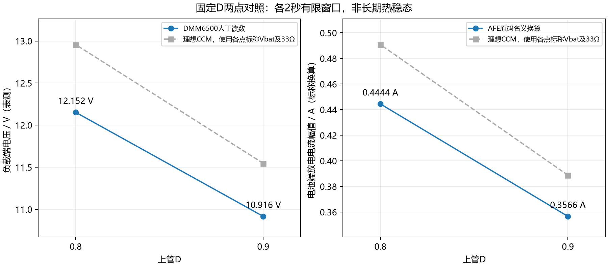
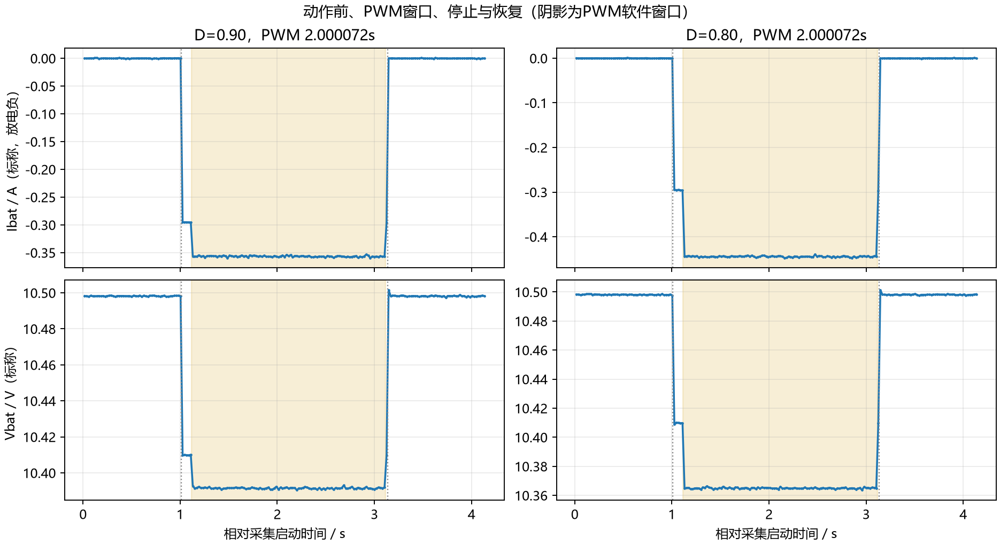

# G03放电开环验收展示报告

验收日期：2026-11-03。实测日期：2026-11-02。已完成D=0.90、0.80两个固定占空比的真实放电、各2秒采集与负载电压表测，正常自动停止和恢复通过。G03整体为in_progress；这两个受限功能点verdict=pass，不能写成六点稳态、最终精度或双向全部通过。

## 现场可展示结果

|上管D|负载电压/V，DMM人工读数|电池电流/A，AFE标称换算|电池串电压/V，AFE标称换算|负载电流/A，仅按33Ω标签换算|
|---|---:|---:|---:|---:|
|0.90|10.916|-0.3566|10.3915|0.3308|
|0.80|12.152|-0.4444|10.3650|0.3682|

两点同一r4镜像、同一接线和供能设置，D固定，PWM期实际CCR/ARR分别1800/2000、1600/2000，未接入PI或其他跟踪反馈。D从0.90降为0.80，负载电压上升1.236V，放电电流幅值增加约0.0878A。项目电流约定充电正、放电负，因此局部有符号ΔIbat/ΔD约+0.878 A/单位D；只代表这两个点附近的有限差分。

## 动作、截止和恢复

|记录|完整PWM样本|全部组数|PWM软件窗口|PWM关闭后继电器保持|故障/结束输出|
|---|---:|---:|---:|---:|---|
|r4 D0.80短点|4|106|100073us|20100us|0 / 0，资源恢复|
|r4 D0.90长点|95|197|2000072us|20100us|0 / 0，资源恢复|
|r4 D0.80长点|95|197|2000072us|20100us|0 / 0，资源恢复|

每点有1s前基线、100ms继电器稳定阶段、PWM窗口、20ms续流路径保持及1s恢复记录。软件窗口是寄存器操作时间，未用示波器测定Vgs或功率管的电气关断时间。正常截止由独立TIM2执行；STOP优先、数据失效退出、故障锁存、一次令牌和防重放保留。硬件带载STOP命令的专项时延未新增验收，不能用本次正常自动截止代替。

2秒窗口最后0.5秒各有24个完整样本。D0.90：Ibat −0.359394～−0.353291A，Vbat 10.3909～10.3931V；D0.80：Ibat −0.447485～−0.442576A，Vbat 10.3637～10.3658V。用户报告负载电压均小幅波动、较稳定，无CC/跳闸或明显异常。可描述为这段有限窗口内稳定响应，不宣称长期热稳态。跨停止边界的样本已标记，未纳入完整PWM样本中位数。

## 数值来源和理论对照

- 实测原始数据：AFE帧、PEC、时间戳、ADC2原码、CCR/ARR、输出位与停止事件；负载电压为Keithley DMM6500前端DCV100V人工读数，未与MCU逐样本同步，仪器参考精度未独立验证。
- 标称换算：AFE电压0.1mV/码；Ibat=(本次原码−本次零点)×0.0001×1.326666673 A。physical_valid仍为0，不能写成完成最终电流精度标定。
- 负载电流是Vload/33Ω标签的计算值，没有串接电流表实测；电阻实际阻值与安装后的连续散热能力未标定。它与电池电流分列，不能互相替代。若计算功率，电池端只用Vbat×Ibat，负载端只用Vload²/33；不跨端口混算，不据这些未校准量验收效率。
- 模型：理想CCM升压Vload=Vbat/D、Iload=Vbat/(33D)、|Ibat|=Vbat/(33D²)。按各点实测标称Vbat预测，D0.90的Vload约11.546V、|Ibat|约0.3888A；D0.80约12.956V、0.4908A。理论差异保留，未通过改系数使两者吻合，也没有把模型反推数据填进空缺列。
- 温度：每组保留GPIO2/3/4与REF2原码和质量标志，没有可靠摄氏度标定；长点温度原码中位约3197/3200/3194和3198/3201/3195。ADC2负载电压原码未证实有效，不用于物理输出电压曲线。

## 课程要求、工程工况和实物边界

课程任务2明确开环扫描在放电下进行，记录负载电压并比较理论；PPT列D=0.90、0.80、0.70、0.60、0.50、0.40。0.5～0.8A结合课程电流环支路按电池端电流理解，不能套到负载电流。本轮两点标称|Ibat|均低于0.5A，因此不宣称达到该电流范围。

|课程D|理想Vload/V，Vin=10.5V|理想Iload/A|理想Ibat幅值/A|本轮|
|---|---:|---:|---:|---|
|0.90|11.667|0.354|0.393|已完成有限窗口|
|0.80|13.125|0.398|0.497|已完成有限窗口|
|0.70|15.000|0.455|0.649|超0.550A退出边界，未执行|
|0.60|17.500|0.530|0.884|超0.550A退出边界，未执行|
|0.50|21.000|0.636|1.273|超0.550A退出边界，未执行|
|0.40|26.250|0.795|1.989|超0.550A退出边界，未执行|

本轮工况是工程探索范围：三节真实电池取出，由三路独立3.500V电源替代，CC0.600A、OCP0.550A启用、OVP3.650V启用；黄色充电口空，绿色33Ω/25W标签负载。EG3112由原图U1确认，PA9上管/PF7下管，D=CCR2/ARR，双低关断；PG5为放电继电器，PB5始终低。供能依据同板课程拓扑及用户接线，18V为辅助/继电器供电，未宣称完整通断审计。

CC/OCP约束持续供能，驱动内部互锁/死区、本地截止和AFE慢速监测提供本次退出路径。PA1不作保护；33Ω、短时间或人工拔电都不被当成内部故障电流限制。电源输出电容和板上储能、OCP响应时间、瞬时内部故障电流上限仍未量化，未验收硬短路耐受。

## 保留的失败及处理

r1负载漏插且停止延迟存在软件缺陷，保留为空载失败。r2修复后D0.90/100ms带载响应通过。r3 D0.80请求在PWM前遇cell13=3.2207V而退出；静态3.4/3.5/3.6V辨识确认CH1/A→cell13、CH2/B→cell7、CH3/C→cell1，纠正此前把cell13称为CH3的口头错误。用户确认CH1/A接触问题并重新夹牢，r4在原阈值下通过短点和长点，支持接触处理有效；没有抹去r3失败或降低阈值。

r4还修正故障后恢复计数：保持原故障锁存，但允许新鲜的停机后样本证明恢复。23项适配层模型、13项最终主机检查通过；原21项核心、旧三次继电器和15项PWM禁能证据按未受影响范围继承。r3唯一长窗口禁能197组沿用正常路径；r4独立默认关闭核对。Release0错0警告，Debug仅原EXTRAM警告。HEX烧录读回和COM12运行身份均确认。

## 文件与验收差项

- [完成点CSV](completed-points.csv)、[课程六点理论CSV](course-points-theory.csv)、[局部方向计算](local-direction.json)、[人工表测记录](user-observations.json)。
- [D0.90逐组CSV](live-d90-long-01/points.csv)、[D0.80逐组CSV](live-d80-long-01/points.csv)、[D0.80短点CSV](live-d80-short-01/points.csv)。每个目录同时有原始串口、结构化报告、manifest和stop-events.csv。
- [现场操作步骤](operation-guide.md)、[镜像哈希](firmware-hashes.json)、[源码清单](production-source-manifest.json)、[烧录读回](flash-01/result.json)。
- [r4 Release HEX](firmware/BMS_PWM_Power_Release/BMS_PWM_Power_Release.hex)，SHA256 `d24854613869c973c3483ebc7ca7d973fb5bf2ca67e75ca8789ff454b5703784`。

可演示：固定D放电与电压变化、AFE电流响应、自动截止与恢复、故障锁存和一次令牌机制；现场按操作步骤逐次启动。仍缺：课程其余D点与0.5～0.8A工况、最终V/I/T精度、长期热稳态，以及探头下的PWM波形/实际死区/Vgs/电感纹波/电气关断验证。缺探头不否定本报告的电压、电流原码响应和软件停止结果。

本轮仅放电。若G03全部完成还包含充电，需要黄色口额外受限充电源和可吸收充电能量的真实电池或四象限模拟器；普通三路电源不能自动当成吸收电源。本次未接充电源、未写双向通过。最终用户已确认三路OFF，MCU输出关闭、令牌已用。

最终收工串口核对见[关闭状态记录](final-off-query-01/result.json)：faults0、bits0、owned0、restored1、used1；未在收工后重新启动。
